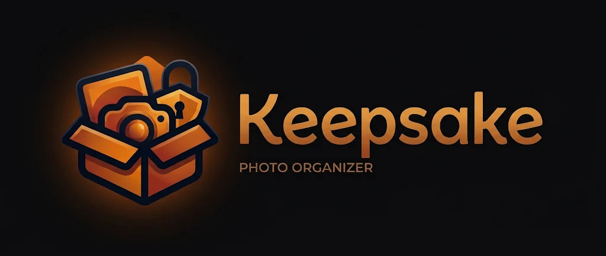

<p align="center">
  
</p>

# Keepsake

> **Work in progress.** It works on the author's library every day, but expect rough edges, schema changes
> and missing features. Issues and pull requests are welcome.

Keepsake is a private, local-only photo organiser. It sorts, searches, cleans up and secures a photo and video
library entirely on your own computer: no account, no cloud, no telemetry, and no internet connection needed to
use it.

The goal is a simple application that can organise, manage and protect a whole photo library with zero network
access. Everything it learns about your photos stays in a database on your machine, the AI runs on your own CPU
or GPU, and sensitive photos can be locked away in encrypted vaults.

## Highlights

- **Works offline.** Nothing about your photos ever leaves the machine. See [Privacy](#privacy) for the two
  optional downloads and how to avoid even those.
- **Organises without touching your photos.** Files are filed into dated folders, and every extra detail
  (dates, GPS, tags, AI vectors) lives in Keepsake's own database. Photos themselves are never edited.
- **On-device AI search.** Type "kids on the beach" or "red car 2019" and find matching photos and moments
  inside videos, using a CLIP model running locally.
- **Albums three ways.** Virtual albums are lists, folder albums are real folders on disk, and secure albums are
  encrypted vaults with their own password.
- **Clean-up tools.** Find exact and near duplicates, and blurry, dark or blown-out shots, and remove them safely.
- **Your files stay yours.** Plain folders on disk, nothing proprietary. Stop using Keepsake and your library is
  still a normal folder of photos.

## Features

### Library

- Year › Month › Day tree beside a thumbnail grid grouped by day. Click a photo for a large preview with its
  capture date (and where that date came from), camera, size, GPS and Google Takeout description.
- A filter bar narrows the grid by file type, camera, location, file size, megapixels, shape (landscape,
  portrait, square), album and file name.
- Each tile shows coloured dots for the albums the photo is in, and videos show their length.
- Right-click any photo, or a Ctrl/Shift-click selection, to open it, show it in its folder, find similar photos,
  add it to an album, remove it from the library or delete it.
  - Removing is a soft delete: the file stays on disk, is hidden, and is never re-imported. Restore from Settings.
  - Deleting from disk asks first and uses the Recycle Bin.

### Import and organise

- **Import folder…** checks every photo and video in any folder, Google Takeout exports included, against the
  library:
  - *Present*: an identical file is already there.
  - *Similar*: a re-saved, edited or resized version of a photo you have. Shown side by side so you decide.
  - *Missing*: copied into its dated folder. The source folder is never changed.
- **Organise…** previews, then moves everything into `YYYY\YYYY_MM\YYYY_MM_DD\<original name>`.
  - Exact duplicates go to `_Duplicates` and undated files to `_Undated`.
  - Every run is logged and can be undone.
- Capture dates come from, in order: camera EXIF or video metadata, a date and time in the file name, other EXIF
  dates, Google Takeout metadata, then a date-only file name.

### AI tools (on device)

- Uses OpenAI's CLIP model running locally through ONNX Runtime. Six sizes are available, from a 150 MB
  quick model to a large, more accurate one.
- **Search in plain English**, optionally with a year: `birthday cake`, `snow mountains 2016`, `receipt`.
- **Find similar** photos to any photo, and browse an automatic **tag cloud**.
- **Events** group the library by time, place and appearance.
- **Videos** are indexed from a frame every few seconds, so a search finds the moment that matches. The result
  shows "▶ 1:20 / 3:10" and the preview opens on that frame.
- Optional **GPU acceleration** on any DirectX 12 graphics card through DirectML, with no CUDA install. Full
  precision models index about ten times faster on a GPU.

### Albums

Right-click photos anywhere and choose *Add to album*. Each album has a name, colour, cover and type:

| Type | What it is | A photo can be in |
|---|---|---|
| **Virtual** | A list in Keepsake's database. Files don't move. | Any number |
| **Folder** | A real folder, `_Albums\<name>`. Adding a photo moves its file there; removing it moves it back. | One |
| **Secure** | An encrypted vault with its own password. | One |

Folders you create under `_Albums` yourself become albums after a rescan.

### Secure vaults

For scanned documents, IDs and anything else you want kept private.

- Adding a photo encrypts it into the vault and checks the encrypted copy decrypts to the same bytes. Only then
  is the original deleted permanently, not to the Recycle Bin.
- Every trace of the photo leaves the rest of the library: its database entry, AI index entries, tags, album
  memberships, cached thumbnail and log entries.
- A locked vault shows only grey lock tiles. Once unlocked, thumbnails and previews are decrypted into memory
  only, never to disk.
- Vaults lock by hand, after 10 idle minutes, and when Keepsake closes. The key is wiped from memory.
- From an unlocked vault you can export a decrypted copy, move a photo back into the library, or delete it.
- Each vault has its own password. **There is no recovery key: a forgotten password means those photos are gone.**

The encryption is described under [Vault format](#vault-format).

### Clean-up

- **Duplicates** groups copies at four levels of risk:
  - Byte-identical files.
  - Re-saved copies.
  - Near-identical shots.
  - Merely similar shots, when the library is AI-indexed.

  Each group keeps its best copy and ticks the rest for removal. A RAW file is always kept over its JPEG twin.
- **Quality** measures brightness, contrast and sharpness once, then a strictness slider surfaces black,
  blown-out, flat and blurry photos, worst first, with the reason under each.

### Formats

JPEG, PNG, WebP, GIF, BMP, HEIC, TIFF, Photoshop PSD/PSB, RAW (CR2, CR3, DNG, NEF, ARW, ORF, RW2, RAF) and
common video formats (MP4, MOV, M4V, 3GP, AVI, MTS, MKV, WMV), including Pixel motion photos from Google Takeout.

- **HEIC** and **TIFF** use Windows' own decoders. HEIC needs the free "HEIF Image Extensions" and "HEVC Video
  Extensions" from the Microsoft Store, which most PCs already have.
- **RAW** previews come from the camera's embedded JPEG, turned upright. A DNG with no preview is rendered from
  its sensor data.
- **PSD** previews come from the flattened image Photoshop stores inside the file.
- **Video** thumbnails, previews and AI indexing need ffmpeg (see [Privacy](#privacy)).

### Settings

- Library folder.
- Tile size, thumbnail resolution and quality.
- AI model and GPU.
- Search tuning, and video frame sampling.
- Restoring removed photos.
- A *Storage and indexes* card shows what Keepsake stores. Each row has a button to clear the thumbnail cache,
  delete a model you're not using, delete an AI index or clear quality measurements.

## Privacy

Keepsake makes **no network connections on its own**. There are three, each made only when you click its
button:

| Connection | To | Needed for |
|---|---|---|
| Download the CLIP AI model, 150 MB to 1.7 GB | Hugging Face (`huggingface.co/Xenova/...`) | AI search, tags, events, similar photos |
| Download ffmpeg, about 200 MB | GitHub (`BtbN/FFmpeg-Builds`) | Video thumbnails, previews and AI indexing |
| *Check for updates* in Settings | GitHub Releases for this repo | Updating Keepsake |

Everything else works without any of them. There is no telemetry, no automatic update check and no account.

**Fully offline machines** can install both by hand:

- **The AI model:** copy the four files of the model you want into
  `%LOCALAPPDATA%\PhotoLibrary\ai_models\<model id>\`. Each comes from `https://huggingface.co/Xenova/<repo>`:
  - `vision_model_quantized.onnx` and `text_model_quantized.onnx`, from that repo's `onnx` folder. Use the
    `_quantized` versions for the int8 ids, and `vision_model.onnx` and `text_model.onnx` for the others.
  - `vocab.json` and `merges.txt`.

  | Model id | Repo |
  |---|---|
  | `clip-vit-base-patch32-q8`, `clip-vit-base-patch32` | `clip-vit-base-patch32` |
  | `clip-vit-base-patch16-q8`, `clip-vit-base-patch16` | `clip-vit-base-patch16` |
  | `clip-vit-large-patch14-q8`, `clip-vit-large-patch14` | `clip-vit-large-patch14` |

- **ffmpeg:** put `ffmpeg.exe` in `%LOCALAPPDATA%\PhotoLibrary\tools\` or anywhere on your `PATH`. Then click
  *Check again* in Settings.

What Keepsake keeps, all on your machine:

- `%LOCALAPPDATA%\PhotoLibrary\library.sqlite` holds the index of your library, AI vectors and tags, albums and
  settings. Deleted entries are overwritten, not just unlinked.
- `%LOCALAPPDATA%\PhotoLibrary\thumbs\` holds the thumbnail cache. Vault photos are never cached.
- Inside your library: `_Albums` (folder albums), `_Vault` (encrypted vaults), `_Duplicates`, `_Undated` and
  `_Logs`.

## Download

From the [Releases](https://github.com/verenion/PhotoLibrary/releases) page, get either:

- **`Keepsake-win-Setup.exe`**, the installer. It installs for your Windows user only, in
  `%LOCALAPPDATA%\Keepsake`, with no admin prompt, and adds a Start menu shortcut. Uninstall from Windows
  *Settings › Apps*.
- **`Keepsake-win-Portable.zip`**: unzip anywhere and run `Keepsake.exe`. Nothing is installed.

Both are self-contained, so .NET doesn't need to be installed, and both have a `.sha256` file beside them to
check the download. The app isn't code-signed yet, so Windows SmartScreen may warn the first time: choose
*More info › Run anyway*.

**Updating:** open *Settings › Updates* and click *Check for updates*. If there's a newer release, Keepsake
downloads it (usually just the changed parts, a few MB), then *Restart to update* installs it and reopens.
Keepsake never checks by itself. Your library, database, AI models and settings live outside the app folder, so
updating, reinstalling or uninstalling doesn't touch them.

## Releasing

Pushing a version tag builds, tests and publishes a release. Nothing else does.

```
git tag v0.1.0
git push origin v0.1.0
```

The workflow packs the app with [Velopack](https://velopack.io) into the installer, the portable zip and the
update packages. A delta from the previous release is included when there is one. A tag with a suffix, such as
`v0.2.0-beta.1`, becomes a pre-release, which *Check for updates* ignores. Release notes are generated from the
commits since the previous tag. Every push to `main` and every pull request is also built and tested, but
documentation-only changes are skipped.

## Run

Requires Windows 10 or 11 and the .NET 10 SDK.

```
dotnet run --project src\PhotoLibrary.App
```

Open `PhotoLibrary.slnx` in Visual Studio, Rider or VS Code. The `.vscode` folder has launch and build tasks.
Build output goes to `%LOCALAPPDATA%\PhotoLibraryBuild`, outside the source tree.

The UI is built with Avalonia, which is cross-platform, but Keepsake is only tested on Windows. HEIC and TIFF
decoding, GPU acceleration and the Recycle Bin use Windows components.

## Project layout

- `src/PhotoLibrary.Core` covers the index, metadata, hashing, import, organise, albums, vaults and image
  decoding. It has no UI.
- `src/PhotoLibrary.AI` covers the CLIP model wrapper, vector index, tagger, events, duplicates and quality.
- `src/PhotoLibrary.App` is the Avalonia desktop app.
- `tests/PhotoLibrary.Tests` holds the xunit tests. AI tests skip themselves when no model is downloaded.

The code and data folders still use the working name `PhotoLibrary`.

## Vault format

Each vault is a folder `_Vault\<random id>` holding `vault.json` and one `<random>.plv` file per photo.

- **Password:** it goes through Argon2id (64 MiB, 3 passes, 4 lanes, recorded in `vault.json` so they can be
  raised later). The result unwraps a random 256-bit vault key with AES-256-GCM. Changing the password re-wraps
  that key; no photo is re-encrypted.
- **Files:** each `.plv` has a random salt. HKDF-SHA256 derives a per-file key from it and the vault key. The
  photo's details (original name, dates, camera, GPS) and its contents are sealed with AES-256-GCM in 1 MiB
  records. Each record's nonce carries its index and a final-record flag, so altered, reordered or truncated
  files are rejected.
- **What's visible on disk:** only how many items a vault holds and roughly their sizes.

**Known limits:**

- Videos show no thumbnail inside a vault, because decoding them would need a temporary decrypted file.
- Identical copies of a photo elsewhere in the library stay unencrypted. The confirmation says how many.
- Importing the same photo again from another folder would bring it back unencrypted.
- Old Organise and Import logs in `_Logs` may still name the file.
- Deleted originals may still be recoverable from an SSD's raw storage or Windows' own thumbnail cache.

## Tests

```
dotnet test
```

`IntegrationTests` uses real camera JPEGs from the folder named by the `PHOTOLIBRARY_SAMPLES` environment
variable when it is set, and generated images otherwise.

## Licence

MIT, see [LICENSE](LICENSE). Third-party components and the optional downloads are listed in
[THIRD_PARTY_NOTICES.md](THIRD_PARTY_NOTICES.md).
